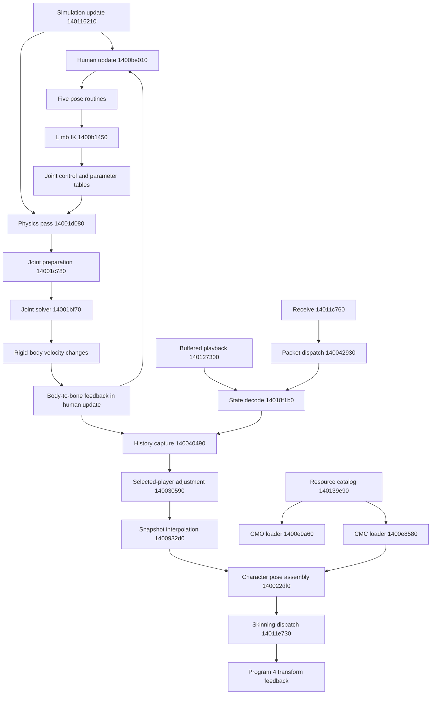

# Human pose, physics and character rendering trace

2026-10-03. Static trace of the pinned vanilla Windows executable:
`e9500422582b7e550be25f6b31e8cdf00b728ae733d5444868c89982c1526c5e`.
This establishes instruction/reference paths and structural asset coverage.
It does not establish complete ragdoll behavior or runtime parity.

## Traced paths

History capture reads the live human/bone tables. The graph connects storage
consumers and producers; it does not imply that capture performs a fresh
post-physics synchronization. The copy into bones occurs within human update,
before the physics pass in the ordered sequence below.

## Callers and update order

`0x140116210` is called at `0x14003bcbc` and `0x14007f31d`. Its original
instructions contain this ordered sequence:

| Call site | Target | Observed role |
| --- | --- | --- |
| 0x140116418 | 0x1401154d0 | Preceding update; semantics unresolved |
| 0x14011641d | 0x140108930 | Writes joint work for other objects; complete role unresolved |
| 0x140116422 | 0x1400be010 | Human update and pose dispatch |
| 0x140116427 | 0x1400ce370 | Intervening update; semantics unresolved |
| 0x14011642c | 0x1400cc610 | Intervening update; semantics unresolved |
| 0x140116431 | 0x14001d080 | Physics/constraint pass |

Before this call sequence, `0x140116210` traverses 8,192 rigid bodies. Records
with active word +0 nonzero and word +8 zero have linear Y velocity reduced by
original float **0.0027222223579883575**, then position advanced by linear
velocity. It calls orientation integrator `0x14012b2d0` with matrix +0x3c,
angular state +0x60, derived velocity output +0x6c and diagonal factors +0x90.
These values are per update in the recovered storage convention; real-time
units and tick frequency are not established by this arithmetic alone.

The preceding update `0x1401154d0` independently advances the point-state pool
at `0x151a84908`, stride 0xf0, retaining previous position/velocity and applying
its stored Y acceleration in one mode. That pool is distinct from rigid bodies.

All six direct calls to the limb solver are found in five functions:

| Caller | Call site(s) | Observed solver arguments |
| --- | --- | --- |
| 0x1400ad2b0 | 0x1400b094c, 0x1400b0f80 | Trunk 2, branch 4/7; reach 0.65625 |
| 0x1400b78f0 | 0x1400b896f | Trunk 0, branch 10/13; reach 1; limit about pi/4 |
| 0x1400b9d90 | 0x1400ba196 | Trunk 0, branch 10/13; flags 0 |
| 0x1400ba210 | 0x1400ba85b | Trunk 0, branch 10/13; flags 24 |
| 0x1400bca30 | 0x1400bddc3 | Trunk 0, branch 10/13; variable flags |

The human update calls `0x1400ad2b0` before selecting lower-limb routines.
Movement-state storage is Human+0x58, matching Sandium's proposed field.
Observed dispatch after state/input transitions: states 0/1 to `0x1400bca30`,
2 to `0x1400ba210`, 3 to `0x1400b78f0`, and 4 to `0x1400b9d90`.
Input mask 0x80000 participates in selecting state 2. Names such as walking,
climbing or falling are not assigned until their input/state behavior is traced.

Sandium's converter names branches 4/7 as arms and 10/13 as legs. These names
are supporting references; native bone identity and rest-pose validation remain
necessary. Its earlier CMC notes contain conflicting tentative names.

## Storage identities

| Storage | Base/stride | Evidence and interpretation |
| --- | --- | --- |
| Human array | 0x18329e308 / 0x6ff8 | Sandium base agrees with native human indexing |
| Human bones | Human+0x220 / 0x138 | 16 packed records; orientation starts at Bone+0x34 |
| Bone joint link | Bone+0x120 | Native IK reads a signed ID at 0x18329e648 plus human/bone strides |
| Rigid-body pool | 0x1449816e0 / 0xbc | Native allocator at 0x14005cf80 and solver use the same pool |
| Joint work | 0x1b4037c40 / 0x90 | Two ushort body IDs at +0/+2; prepared work and control values |
| Joint parameters | 0x1b4287c80 / 0xf4 | Persistent configuration; solver scans 0x4000 records |
| Render uniforms | 0x145f18c00 / 0x3c0 | Per-human 16 origins, 16 positions, 16 mat3 orientations |

The 144-byte work record is separate from the 188-byte rigid-body record.
Its control vector at +0x10 is `0x1b4037c50`, indexed by a **joint ID** read
from the bone. This resolves the earlier apparent stride discrepancy.

Rigid-body fields traced through joint preparation, solver and accumulation:

| Offset | Observed use |
| --- | --- |
| +0x14 | Mass-related weighting input; existing allocator stores mass here |
| +0x18 | Position |
| +0x24 | Linear velocity |
| +0x30 | Accumulated linear velocity change |
| +0x3c | Orientation matrix |
| +0x60 | Angular state updated from the accumulator; momentum-like interpretation remains tentative |
| +0x6c | Derived angular velocity used by the joint solver |
| +0x78 | Accumulated angular-state change, applied to +0x60 |

The body loop adds linear changes to velocity and angular changes to +0x60,
then derives +0x6c through orientation and scale-related fields. Treating +0x78
as a direct angular-velocity increment would miss that conversion. Remaining
fields and units are unresolved.

## Active control rather than pose-only IK

The limb solver computes quaternion-relative orientation corrections, resolves
quaternion sign, normalizes correction axes, caps a correction using the caller's
limit, transforms through bone orientation and writes joint control vectors.
It also adds half of a supplied three-component input vector. Flags 2, 4, 8 and
16 select different orientation/correction paths. Flag 16 invokes
`0x1400b2bf0` and `0x1400a9940`.

`0x1400b2bf0` bounds a vector relative to the difference of two bone velocity
vectors. `0x1400a9940` compares relative rotation components with per-bone lower
and upper limits, then transforms the corrected vector back. Exact units and
the complete angular representation need validation.

Native reach calculation uses a scalar square root, a clamp to absolute reach,
division by reach, angle helper `0x14023e7d4`, and a **double -2.0** multiplier
at `0x140278cc0`. Do not interpret that address as a float zero or replace the
sequence with guessed trigonometry. The helper's full contract remains open.

Joint preparation `0x14001c780` links body IDs from joint parameters into work,
transforms anchor offsets, computes mass ratios and scales the control vector
by **0.875**. Joint solver `0x14001bf70` consumes the prepared vector and relative
angular velocity, applies a magnitude limit from Joint+0x88 when enabled,
and accumulates changes to both bodies. This is a concrete actuator path from
pose targets to physical motion; full gain/limit semantics are still partial.

The native physics pass loops for **32 iterations**. The loop bound is
`CMP R15D,0x20` at `0x14001f994`. This is solver iteration count, not evidence
for a 32 Hz simulation timestep. Timestep, contact ordering, damping, sleeping
and all constraint kinds remain separate recovery tasks.

### Additional anchor correction and vehicle passes

The iterative solver dispatches joint-work kind 7 to `0x14001cbb0`, a limited
anchor correction. It reads anchors at work+0x20/+0x2c, desired vector at +0x10,
gain at +0x44 and body ratios at +0x3c/+0x40. It combines linear velocity and
anchor/angular terms, caps correction magnitude at original float
**0.033333335** (`0x3d088889`), and accumulates linear and angular-state changes
to both bodies. This cap is a solver parameter; its numerical resemblance to
a 30 Hz interval does not establish the simulation tick rate.

Rust translation in `rust-client/src/physics.rs` matches **1,024 native cases
bit-for-bit**, with finite inputs, distinct bodies, zero/small/large corrections,
asymmetric ratios and one or 32 repeated calls. All untouched body bytes and
joint-work records were preserved. Integration between iterations and same-body
alias cases are not covered by this kernel comparison.

Joint constructors are now traced to first-free allocation across 16,384
persistent records, with zero-initialized parameter payloads and work records:

| Constructor | Stored kind | Observed setup |
| --- | --- | --- |
| 0x14004e160 | 7 | Two body IDs, two anchors, extra argument at +0x64; defaults +0x70=0.25/+0x74=0.375 |
| 0x14004e430 | 7 | Same two-body/anchor setup, without the extra +0x64 argument |
| 0x14004e2e0 | 4 | One body, anchor and further vector; defaults 0.0625/0.125 |
| 0x14004e5b0 | 8 | Two body IDs; defaults 0.0625/0.125 |
| 0x14004de30 | 0 | Distinct point-state IDs, duplicate-pair and attachment-count checks |

These are stored kind numbers and setup contracts, not a complete semantic enum.
The first four constructors return -1 when the pool is exhausted. Kind 7/8
creation stores -1 at +0xa0 and 0x10000 at +0x0c. Separate `0x14005d1f0`
constructs a chain of objects using kinds 7 and 8; it is not collision generation.

Physics also calls `0x14010d610` before joint solving and `0x140107ed0` after
each joint iteration. Both traverse 512 item records at stride 0x5168 and use
subrecords with stride 0xac, their count at item+0x3940. They read item body IDs,
orientation and subrecord contact/force data. Their equations and vehicle/wheel
roles are still partial. Those extra passes are evidence that a joint-only port
would omit behavior.

### Angular integration stages

Orientation integrator `0x14012b2d0` computes four matrix-dependent angular
velocity estimates using angular state and diagonal factors. It makes temporary
rotations for the next estimates and combines them with weights **1,2,2,1**
times original float **0.1666666716337204**. The final length calculation uses
original float **0.0277777798473835**. This is a four-stage angular integration
path; exact stage rotations and helper register ABI need recovery before porting.

Rotation helper calls are at `0x14012b59d`, `0x14012b847`, `0x14012baa4`,
and `0x14012bcc6`, targeting `0x14007b2a0`. The decompiler drops arguments
at later calls; native register setup must supply the contract. That helper
applies axis-based rotation arithmetic to three matrix vectors and normalizes
each vector. Its packed-angle dependency `0x1401f8ac0` requires the full original
ABI/math path; the existing Rust angle-preparation helper is not a complete
substitute. No angular integrator parity is claimed yet.

Within constraint iterations, body linear deltas add to linear velocity and
angular-state deltas add to +0x60. Angular-state magnitude is capped at body+0x9c
times **8.0**, then transformed by orientation and +0x90/+0x94/+0x98 to derive
angular velocity at +0x6c. Recovering that transformation and its callers is
required before substituting any Bevy or external physics component.

## CMC data and skinning

`0x140139e90` contains 12 direct calls to CMC loader `0x1400e8580` and the CMO
resource loads. Installed files include additional assets; inventory presence
does not prove that the default catalog loads them.

The CMC loader accepts version 2, reads a part count and pivots, then vertices:
world position (12 bytes), a local position/weight record per part (16 bytes),
and two further float-sized words. For 16 parts this is **276 bytes per vertex**.
Faces are triples of 32-bit indices. The loader scales pivots and local positions,
builds processed vertex records, selects the **first four positive influences in
bone order**, and normalizes their retained weights. It does not select the four
largest weights. Installed samples contain 116 vertices with more than four
positive weights, so that distinction affects real data.

Structural cross-check: 48 CMO plus 13 CMC files are consumed exactly, with no
unresolved files or trailing bytes. All CMC samples have 16 parts. The inventory
tool is stricter about magic than behavior established for the native CMC loader;
malformed-input parity is not claimed. File provenance remains unverified.

The exact embedded shader `program_04.vert.glsl` declares 16 bones and four
influences. For each retained positive weight it applies:

`position += weight * (orientation * (vertex - original_bone_origin) + bone_position)`

It blends transformed normals and emits position, UV and normal outputs.
Shader setup at `0x14014b2a0` registers those three transform-feedback outputs.
`0x14011e730` uploads the origin/position/orientation arrays, submits skinning
and captures the outputs. `0x140022df0` assembles these arrays and dispatches
body plus optional additional character components.

## Render pose history

### Body feedback and capture

Human update synchronizes 16 bone records at `0x1400c1453`–`0x1400c157b`,
then calls the upper-limb pose routine at `0x1400c158b`. Each bone's first
32-bit field identifies a rigid body, indexed with stride 0xbc. It copies:

| Body field | Bone field | Data |
| --- | --- | --- |
| +0x18 | +0x04 | Position, three floats |
| +0x24 | +0x1c | Linear velocity, three floats |
| +0x3c | +0x34 | Orientation, nine floats |
| +0x6c | +0x58 | Derived angular velocity, three floats |

This supplies physical feedback to the following pose calculations. Because
the physics pass follows human update, do not treat these copied bones as
automatically refreshed after that same pass.

Update caller `0x14003ba57` invokes simulation at `0x14003bcbc`, then later
history capture at `0x14003c16e` when tick storage `0x183ebfd34` differs from
the last captured value at `0x1a4d3bd30`. Mode branches can bypass simulation;
their complete local/network/replay semantics remain unresolved.

Capture `0x140040490` selects `tick & 0x3f`. Each history slot spans **0x89880
bytes** across multiple entity types. The human region has 256 records with
stride **0x560**. Each record starts at `0x1a4d3bd38 + slot*0x89880 + human*0x560`.
Its first bone position is +0x20 (`0x1a4d3bd58`); its orientation is +0x2c
(`0x1a4d3bd64`). Bone records have stride 0x54, including additional words
whose full meanings remain unresolved.

The initial capture copies root position and all 16 bone orientations from
live human storage. Native root-position stores start at `0x140040581` and
orientation stores at `0x140040599`. The remaining orientations are copied
in an unrolled loop. This is a memory-state capture, not itself a packet decoder.

If ticks were skipped, it fills intermediate ring slots with linear position
and wrapped-angle interpolation and orientation blending. Its wrapped slot
distance adds 64 when the new slot is less than or equal to the previous slot;
equal indices therefore produce a distance of 64 rather than zero. The
independent tick comparison in the caller controls whether capture runs.

`0x140030590` is called at `0x1400419dc` for each filled intermediate slot and
at `0x140041a34` for the final slot. It resolves the human through selected
player storage `0x183f7c540` and player field table `0x151620cfc`, reconstructs
15 further part positions using hierarchy data and matrix composition, and
updates additional history/correction data. If no player/human is selected,
those pose calculations are bypassed. The full purpose of its correction
terms and first-person relationship are still partial.

### Orientation blend contract

`0x1400c2f90(output, left_matrix, right_matrix, factor)` converts both matrices
to four-component quaternions using `0x14010e370`. The first conversion retains
the incoming RDX source argument at native call `0x1400c2fb1`, despite a missing
argument in the decompiler's printed call. If their dot product is negative,
it flips the right quaternion's sign. It then computes `(1-t)*left + t*right`,
normalizes by its length, and converts back to a matrix via `0x14011c340`.
The zero-length fallback is quaternion `(0,0,0,1)`, read from original constants.
This is normalized linear quaternion interpolation. The helper itself does
not clamp the factor; callers establish their own range.

Isolated original-code fixture: **2,100 cases passed**, across 100 rotation
pairs, seven factors (including extrapolation), and three destination alias
arrangements. Matrix components agreed with an independent mathematical
contract within 2.981e-7; input preservation, output guards and orthogonality
also passed. Exactly 180-degree ambiguous paths were checked for matrix
agreement at endpoints and orthogonality at every factor; no unique interior
path is claimed there. This is narrow runtime evidence, not full game parity.

Reproduce with `python scripts/test_client_pose_interpolation.py`; results
are under `reports/human-pose-trace-20261003/orientation-fixture/`.

Rust translation in `rust-client/src/pose.rs` additionally matched all **2,100
cases bit-for-bit** against the native routine, including destination aliasing.
This verification uses finite matrices/factors and the default floating-point
environment; non-finite values and alternate rounding modes remain unverified.

### Received and buffered state producers

The receive wrapper `0x14011c760` fills buffer `0x1853ad424` via `recvfrom`
or alternative transport helper `0x140198c60`. It checks a four-byte header
and can dispatch a secondary decode path `0x14011bd70`; that framing and the
alternative transport are not yet fully specified. Packet dispatch `0x140042930`
calls the receive wrapper at `0x140042972`, updates the simulation tick from
accepted state, and calls shared state decoder `0x14018f1b0` at `0x140043c91`.
Buffered reader `0x140127300` also calls that decoder at `0x14012743e`.
Its file/buffer provenance and replay controls remain to be traced.

Shared decoder `0x14018f1b0` processes human activation/state data and calls
human compressed-state reader `0x14018ef40` at `0x14018fe13`. That reader uses
an eight-bit baseline selector, three position delta fields of width 28,
a two-bit root quaternion component selector and three signed component
fields of width 14. Each of 15 further bones has a changed bit: unchanged
entries copy four words from the baseline; changed entries read a two-bit
selector and three component fields of width 12. The signed/delta behavior
below is recovered statically; complete packet layout and malformed-input
behavior remain unresolved.

Position delta reader `0x14018d510` uses a prefix tree: first bit 0 means a
signed four-bit delta added to baseline; prefix 10 means a signed nine-bit
delta; prefix 11 means an absolute unsigned field with the requested width.
Quaternion delta reader `0x14018d5e0` can first preserve the baseline using
an optional unchanged bit, controlled by global `0x16b2a224c`. Its next prefix
selects a signed delta using global width `0x165d84960` (prefix 0), a signed
delta using global width `0x165d84964` (prefix 10), or an absolute signed
requested-width value (prefix 11). Delta values add to baseline. Absolute
signed reader `0x140115d20` sign-extends the highest field bit; these signed
values use two's complement, not sign magnitude. Raw bit reader `0x140115ae0`
consumes the low remaining bits first and assembles lower-order result bits
first across byte boundaries. All these routines share buffer cursor state.

Rust valid-input translations in `rust-client/src/network_bits.rs` matched
**44,640 native cases**, including values, byte/bit cursor changes and wrapping
baseline arithmetic. Widths 1–31 and every starting bit offset are covered,
with zero/ones/alternating/pseudorandom data. Original malformed-input behavior
is not replicated: the Rust API explicitly rejects unsupported widths and
truncated input. Global decoder statistics are not implemented by the pure reader.

The decoded root position is written to `0x18329e52c/530/534 + human*0x6ff8`.
Root orientation is reconstructed by `0x140191f90` at `0x14018ff31`; further
bone orientations use `0x140192160` at `0x14018ffaf`. The latter are composed
with parent transforms and hierarchy offsets to recover world positions.
Thus received state can populate the same live bone storage captured by history,
without deriving those values from a locally simulated rigid-body pass.

Both quaternion reconstruction helpers read original component order **3,1,2,0**
from `0x140301dd8` and `0x140301df8`. Three explicit components are converted to
floats; the selected omitted component is positive `sqrt(max(0, 1-sum(q*q)))`.
The result is normalized and converted to a matrix. For the root helper,
the component multiplier is the original double **0.00017265456749763092**.
The variable-width helper divides signed integers by `(1 << (bits-1))-1`,
then multiplies by original double **1.414213562373095**. Preserve these actual
constants; substituting a conventional quaternion packing formula without
accounting for the signed readers would be speculation. The decode path has static
native evidence only; the 2,100-case fixture covers interpolation, not compression.

### Render consumer

`0x1400932d0` selects two history slots using a **64-slot ring**, clamps its
interpolation factor to [0,1], interpolates positions and wrapped angles, and
calls orientation interpolation for the 16 parts. It writes the intermediate
pose cache read by `0x140022df0`. That assembler also uses model/bone hierarchy
data to construct the shader arrays; render pose is a separate path from the
actuator calculations.

Open: complete authoritative/local/remote selection, full state packet layout,
latency/time units, alternate modes and first-person component selection.
Received-state writes, history production and orientation blending now have native evidence;
do not assume every history slot originated in a packet.

## Evidence and next recovery targets

### Recovered articulated construction

`rust-client/src/human.rs` now implements the 16-bone/body construction loop
`0x140053a80..0x140053ce1` from human allocator `0x140053840`. The loop follows
integer parent links in the 100-byte templates at `0x18399dee0`, accumulates
ancestor offsets, transforms them into world positions, and copies the original
bone fields. It passes the template's **reciprocal diagonal** to rigid-body
allocator `0x14005cf80`; using the template diagonal directly would invert the
body factors incorrectly. Each body records its human ID at +0xc and bone ID
at +0x10. The isolated loop and full body pools match in 256 native comparisons.

The body allocator clears bytes +4 through +187, selects the first free slot,
sets mass/position/orientation/optional velocity, stores its supplied diagonal,
derives positive inverse factors and a minimum, and sets +0xac/+0xb0/+0xb4 to
0.5/0.25/0.5. It matches across 576 complete 8192-body pool comparisons.

Skeleton builder `0x1400ab7b0` uses human-specific constructor `0x140055fa0`.
Original creation order is `(0,1),(1,2),(2,3)`, then `(0,10),(10,11),(11,12)`,
`(0,13),(13,14),(14,15)`, then `(2,4),(4,5),(5,6)`, `(2,7),(7,8),(8,9)`.
It creates persistent kind-10 joints, copies anchors from child template +0x10,
subtracts child local position for the second anchor, and records child link
IDs at Bone+0x120. The human joint list at Human+0x2da4 stores a count and
three-word `(joint ID, parent bone, child bone)` entries. Full joint/work pools,
all bone bytes and human link records match in 128 native comparisons, including
partial exhaustion. The Bevy world exposes both construction routines.

Evidence: `reports/rust-body-creation-20261003/result.json`,
`reports/rust-human-bodies-20261003/result.json`, and
`reports/rust-human-joints-20261003/result.json`. These checks do not cover the
surrounding human defaults, template production, collision records generated
by `0x1400aaaa0`, controller targets, angular integration or render feedback.
The template producer is `0x140138770`, located by its write reference to
`0x18399dee0`. `scripts/recover_human_templates.py` executes this original
routine with zero-initialized global storage and exports its 1,600-byte startup
result. `rust-client/src/human_templates.rs` contains the corresponding 16 raw
templates, including offsets, joint anchors, body factors and limits. The capture
SHA256 is `80cb93ecf793f305fc55b384cfb7d18201e63b7c2c4908407d6711fada393afc`.
Both construction comparison suites include this actual startup data alongside
their generated cases. This is an initial-data capture, not a port of arbitrary
reinitialization or alternate floating-point modes.

The third-person executable still uses the separately documented single-body
harness; the new construction routines are not presented as complete player physics.

Raw evidence lives under `reports/human-pose-trace-20261003/`: fresh CLI
decompilations/xrefs, original instruction/reference TSVs, identity, constants,
asset inventory and byte-validation report. The exact embedded shader is under
`exports/client/shaders/`, with its pinned-source manifest.

The export contains **31,971 instructions from 61 functions**. Every exported
instruction byte matches the pinned executable; the byte-validation report
has zero mismatches. This validates static evidence, not scenario parity.

Reproduce exports with `scripts/ghidra/ExportHumanPoseTrace.java` through
ghidra-cli. Reproduce structural asset checks with
`python scripts/inspect_client_character_assets.py`.

Next targets:

1. Recover transport framing, complete packet layout and mode selection.
2. Recover remaining contact generators, asset-to-collision conversion and spatial broad phase; response kinds 0–10 and processed mesh-pair contacts now have scoped native comparisons.
3. Map movement-state transitions to controlled original-client scenarios.
4. Compare isolated native IK and joint cases: zero reach, opposite quaternion
   signs, joint limits, asymmetric mass and disabled/free ragdoll states.
5. Verify CMC bind transforms, material/atlas selection and skinning outputs.

These remain unresolved parts of the specification. The Rust rewrite now has
verified bit-reader, pose and anchor-correction modules and a Bevy presentation
plugin. It is not a full game and does not yet establish gameplay parity.
